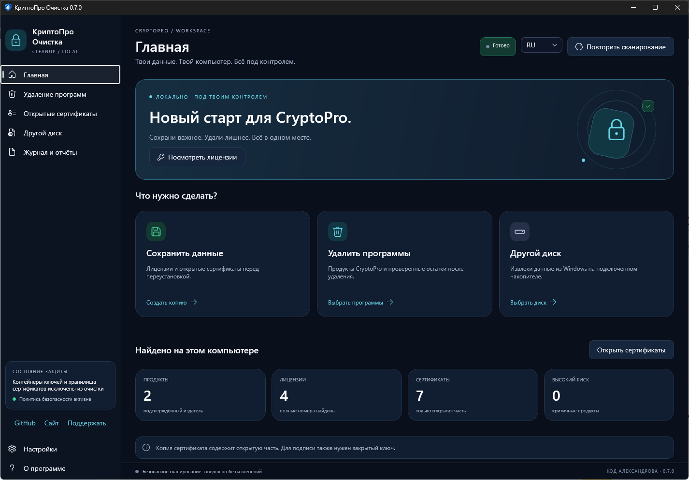
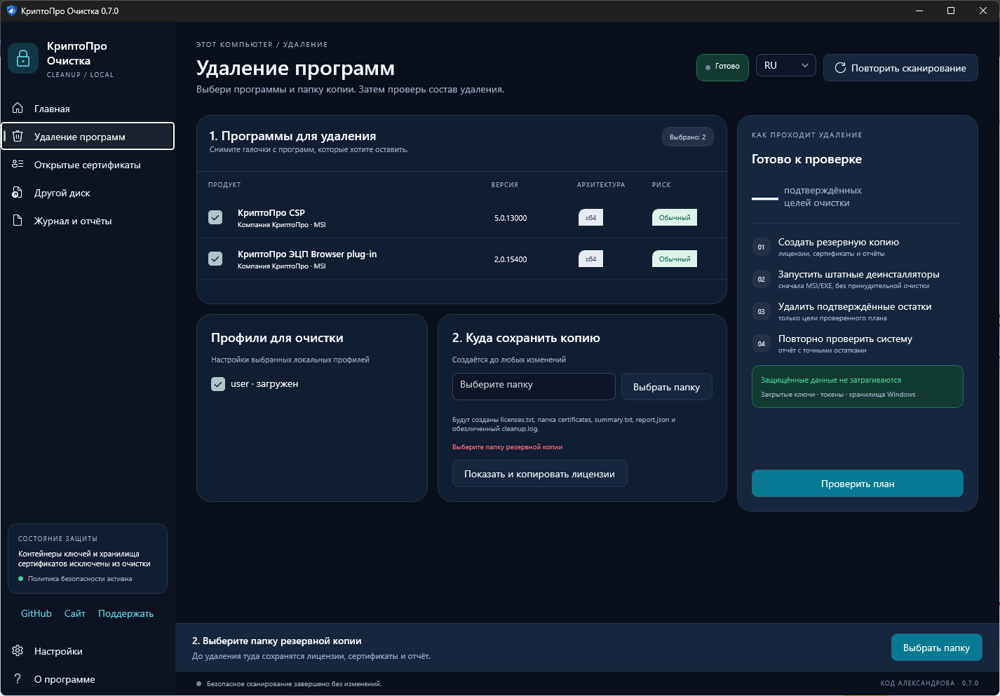
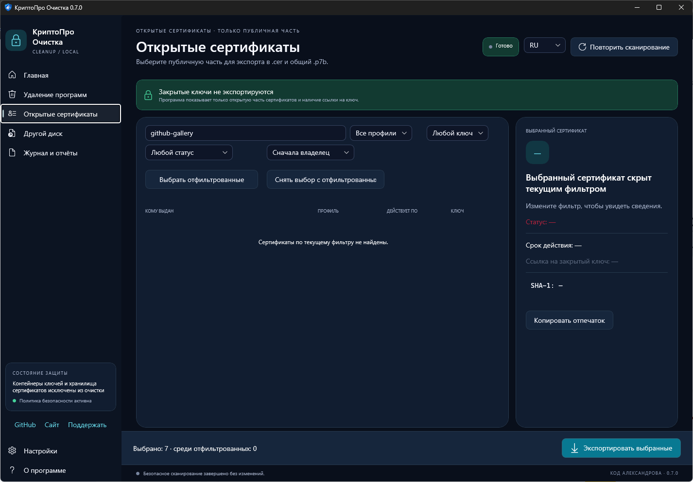
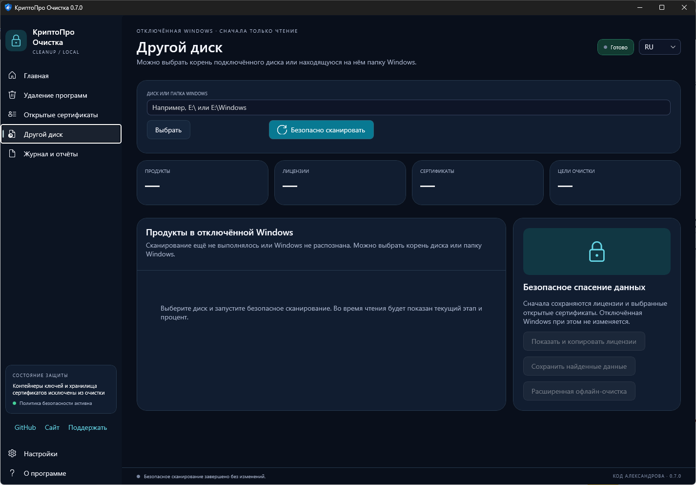
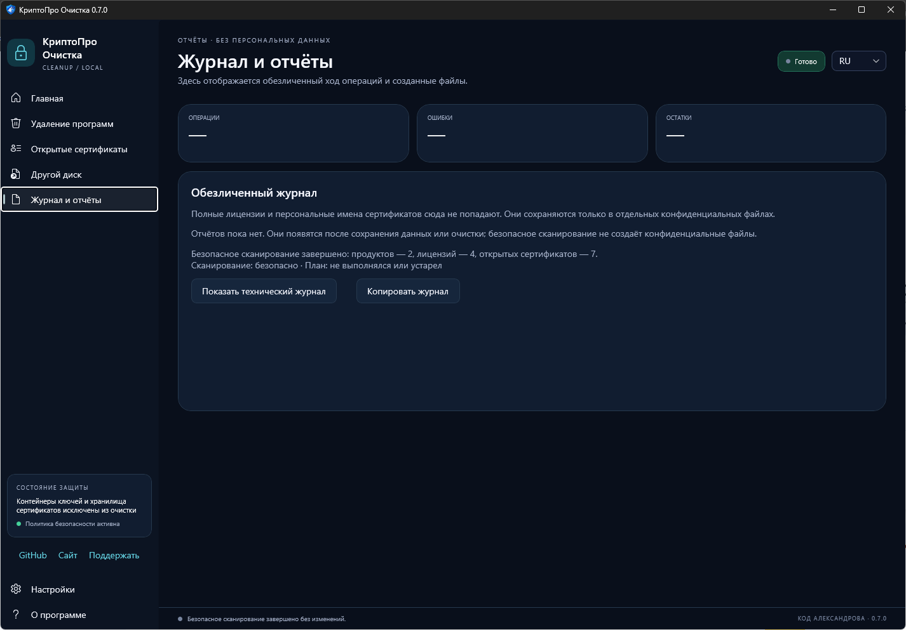
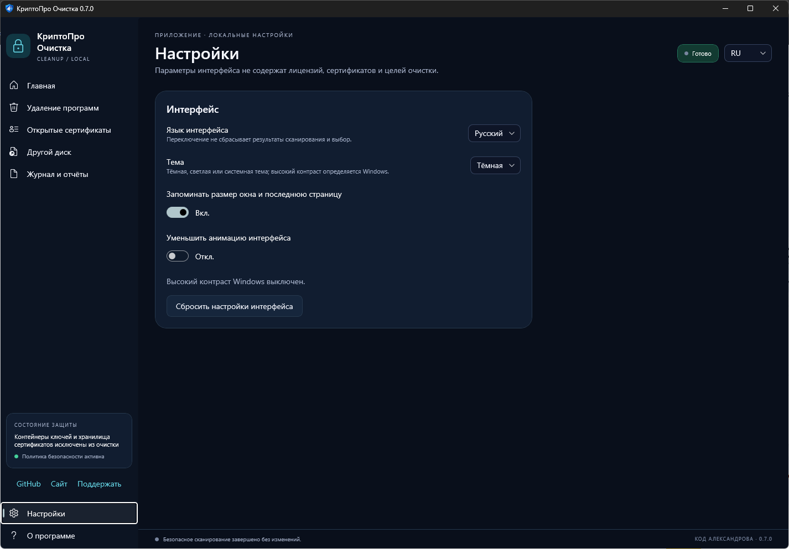
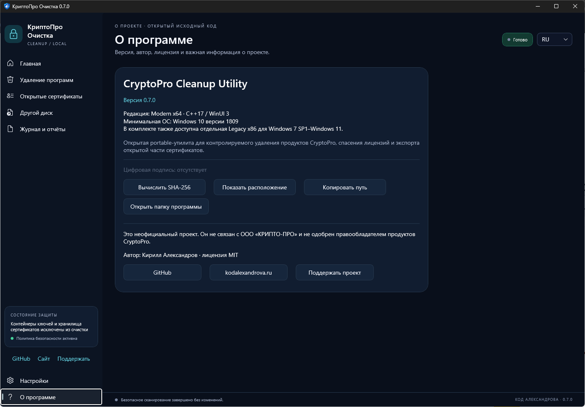
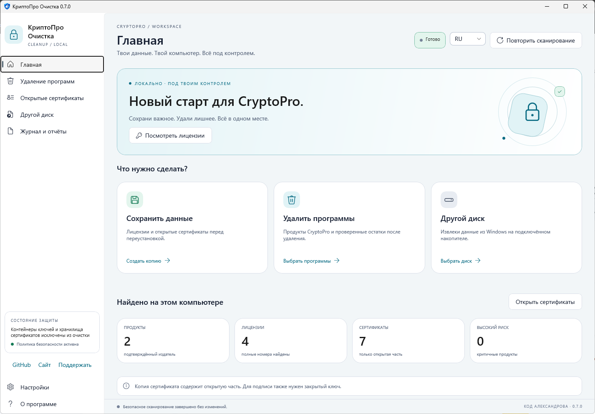

# КриптоПро Очистка

### Сохрани нужное. Удали лишнее. Без запутанных настроек.

**Modern 0.7.0 для Windows 10/11 x64** - новая главная с тремя задачами: сохранить данные, удалить программы или проверить другой диск. Native WinUI 3, светлая и тёмная темы, русский и английский интерфейс. Без установки и отдельного .NET.

Это **предварительный релиз**. [Изменения и результаты проверок](docs/RELEASE_NOTES_0.7.0.md).

[](https://github.com/acidtmn/CryptoProCleanup/actions/workflows/build.yml)
[](https://github.com/acidtmn/CryptoProCleanup/releases)
[](LICENSE)
[](#системные-требования)

> Полное удаление ранее проверено пользователем на Windows 10 x64. На подключённом диске Windows 7 x86 подтверждены обнаружение продуктов, полный номер лицензии и экспорт открытых сертификатов. Результаты этих проверок относятся к предыдущим версиям; новая оболочка проверяется отдельно.

Неофициальная portable-утилита для резервного копирования лицензий и открытых сертификатов, контролируемого удаления установленных продуктов CryptoPro и спасения данных из отключённой Windows 7 SP1–Windows 11.

Проект не связан с ООО «КРИПТО-ПРО». Названия CryptoPro и «КриптоПро» используются только для описания совместимости. Утилита не загружает и не запускает `cspclean.exe`.

**[Скачать Modern 0.7.0](https://github.com/acidtmn/CryptoProCleanup/releases/download/v0.7.0/CryptoProCleanup-Modern-x64-0.7.0.zip)** · [Все файлы и SHA-256](https://github.com/acidtmn/CryptoProCleanup/releases/tag/v0.7.0) · [Legacy для Windows 7/8 и x86](https://github.com/acidtmn/CryptoProCleanup/releases/download/v0.6.0-preview1/CryptoProCleanup-Legacy-x86-0.6.0-preview1.exe) · [English](README.en.md)



<details>
<summary>Все разделы программы и светлая тема - 7 скриншотов</summary>

### Удаление

Выбор продуктов, профилей и резервной копии. Сначала проверка плана, затем отдельное подтверждение удаления.



### Открытые сертификаты

Поиск, фильтры, сведения и экспорт CER/P7B. Личные сертификаты на публичном снимке скрыты поисковым фильтром.



### Другой диск

Чтение отключённой Windows и сохранение найденных данных отдельно от расширенной очистки.



### Отчёты

Понятный результат и обезличенный журнал. Полные лицензии сохраняются в отдельный конфиденциальный файл.



### Настройки



### О программе



### Светлая тема



</details>

## Важное предупреждение

Удаление криптографического ПО может нарушить электронную подпись, вход в Windows, VPN, EFS, TLS и доступ к зашифрованным данным. До стабильного выпуска требуется полная VM-матрица из [docs/TEST_MATRIX.md](docs/TEST_MATRIX.md). В предварительном релизе она ещё не пройдена. Неподписанный EXE может вызвать предупреждение SmartScreen.

Сборка цифровой подписи не имеет. Страница «О программе» проверяет подпись EXE и вычисляет SHA-256 по запросу. Целостность архива можно сверить по `SHA256SUMS-0.7.0.txt`; контрольная сумма не заменяет цифровую подпись.

Утилита намеренно не удаляет:

- сертификаты Windows;
- аппаратные токены и смарт-карты;
- каталоги и ветки реестра с контейнерами закрытых ключей;
- неизвестные объекты, принадлежность которых CryptoPro не подтверждена.

## Возможности

- две portable-редакции с общим проверенным ядром и без .NET/PowerShell: self-contained-папка Modern x64 и один совместимый Win32 Legacy EXE;
- современная Modern-оболочка с единой системой отступов, режимами Dark, Light и System, системными цветами High Contrast, тематическими диалогами и title bar;
- Modern x64 написан на C++/WinUI 3, использует Per-Monitor V2 DPI, тёмную рамку, скругления, Fluent-контролы и системную доступность Windows 10/11;
- оригинальная многоразмерная иконка приложения для Проводника, панели задач, окна и UAC;
- изменяемое и максимизируемое окно с адаптивными таблицами, системным DPI-масштабированием и нативным современным оформлением;
- поиск продуктов по подтверждённому издателю в 32- и 64-битных ветках реестра;
- RU/EN интерфейс, выбор продуктов и локальных профилей;
- резервная копия лицензий, JSON-отчёт и обезличенный журнал до удаления;
- неблокирующая проверка резервной папки: ввод пути не создаёт каталог, файловая проба выполняется в фоне, а интерфейс показывает свободное место и ожидаемый минимум;
- отдельное окно полного номера лицензии с копированием в буфер обмена;
- отдельная вкладка пользовательских сертификатов с флажками и колонками «профиль», «кому выдан», «кем выдан», «действует с/по»;
- экспорт выбранной открытой части в отдельные DER-файлы `.cer`, общий `.p7b` и конфиденциальный текстовый каталог;
- штатная MSI/EXE-деинсталляция перед остаточной очисткой; если деинсталлятор требует перезагрузку, очистка остатков откладывается до защищённого продолжения после входа;
- обнаружение CSP 4.x и 5.x (а также доступных установок 3.x) по издателю и MSI/EXE-метаданным без жёсткой привязки к ProductCode;
- снимок служб, драйверов, COM, криптопровайдеров, браузерных хостов, задач и ярлыков;
- безопасный обход каталогов без перехода по junction/reparse point;
- защищённый RunOnce-сеанс с отдельным нативным `CryptoProCleanupResume.exe`; перезагрузку пользователь выполняет вручную, приложение её не запускает;
- отказ от отдельно подтверждаемого `FORCE` запрещает принудительную остаточную фазу и такое продолжение после перезагрузки;
- безопасный CLI-режим сканирования без удаления.
- отдельная вкладка «Неисправный диск» для чтения отключённой Windows, извлечения лицензий и открытых сертификатов и консервативной расширенной очистки.
- временное подключение настоящих системных `SOFTWARE`, `SYSTEM` и `NTUSER.DAT` через `RegLoadKey` с обязательным `RegUnLoadKey`;
- резервный поиск профилей в `Users` и чтение пользовательского и машинного реестровых хранилищ сертификатов;
- чтение открытых сертификатов из файлового хранилища `AppData\Roaming\Microsoft\SystemCertificates\My\Certificates` без доступа к закрытым ключам;
- копируемая пошаговая диагностика офлайн-сканирования и безопасный параметр `--offline-scan`.
- фоновое сканирование отключённой Windows: окно остаётся отзывчивым, индикатор движется непрерывно, а строка состояния показывает текущий этап.

## Две версии программы

| Файл | Для каких систем | Особенности |
|---|---|---|
| `Modern-Windows10-11-x64\CryptoProCleanup.exe` | Windows 10/11 x64; Windows 11 ARM64 через x64-эмуляцию | Современный C++/WinUI 3 интерфейс; вся self-contained-папка переносится вместе |
| `Legacy-Windows7-11-x86\CryptoProCleanupLegacy.exe` | Windows 7 SP1–Windows 11, x86/x64; ARM64 через x86-эмуляцию | Один x86 EXE для старых и новых систем, API/PE subsystem Windows 7 `6.01` |

Обе редакции используют общее ядро обнаружения, резервного копирования, защиты ключевых контейнеров, штатной деинсталляции и остаточной очистки. Modern 0.7.0 требует Windows 10 версии 1809 или новее, x64. Legacy в этом выпуске не обновлялся; ссылка выше ведёт на отдельно опубликованный 0.6.0-preview1 для Windows 7/8/8.1 и 32-битной Windows. ARM64 через эмуляцию в этой версии отдельно не проверялся.
`CryptoProCleanupResume.exe` в папке Modern является внутренним нативным helper продолжения; не запускайте и не переносите его отдельно.

В настройках Modern доступны Dark, Light и System. System следует теме Windows во время работы, а при системном High Contrast словари приложения используют системные цвета. Переключение темы и языка не сбрасывает результаты безопасного сканирования, выбор сертификата или проверенный план. В 0.5.3 заголовок, фильтры, строки выбора пути, настройки, отчёты и кнопки «О программе» переносятся при недостаточной ширине без сокращения подписей.

Legacy 0.5.3 использует отдельную компактную раскладку для малых экранов Windows 7: при разрешениях 800×600 и 1024×768 все шесть разделов и основные кнопки остаются видимыми, а таблицы, настройки, журнал и вкладка отключённой Windows уплотняются без взаимного перекрытия действий. Минимальный размер окна — 640×480.

## Системные требования

- Windows 7 SP1, 8, 8.1, 10 или 11;
- права локального администратора;
- архитектура и версия ОС согласно таблице выше;
- установка, .NET, PowerShell и интернет для запуска утилиты не требуются; файлы Modern нельзя отделять от соседних DLL/PRI/XBF.

## Установленная Windows

1. Полностью распакуйте Modern ZIP и запустите `CryptoProCleanup.exe`. Не переносите EXE отдельно от DLL и соседних файлов. Подтвердите UAC и дождитесь безопасного сканирования.
2. **Нужна только копия?** На главной выберите «Сохранить данные». Удаление не запускается. Нужные открытые сертификаты предварительно отметьте в разделе сертификатов.
3. **Нужен номер лицензии?** Откройте лицензии с главной и скопируйте полный номер. Перед переустановкой ОС сохраните копию вне системного диска.
4. **Нужно удалить CryptoPro?** Откройте задачу удаления, проверьте продукты и профили, выберите папку копии и переходите к проверке плана. Удаление потребует отдельного подтверждения.
5. Сначала создаётся резервная копия и запускаются штатные MSI/EXE-деинсталляторы. Только затем обрабатываются подтверждённые остатки. Закрытые ключи и сертификатные хранилища не являются целями остаточной очистки.
6. Если потребуется перезагрузка, программа отдельно спросит разрешение на одноразовое продолжение. Перезагрузите Windows вручную; остаточную фазу выполнит нативный helper без повторного запуска деинсталляторов.

В выбранной папке создаётся отдельная подпапка сеанса: `licenses.txt` с полными лицензиями, папка `CryptoProCertificates-*` с выбранными `.cer`, общим `certificates.p7b` и каталогом `certificates.txt`, `summary.txt` с понятным итогом, `report.json` для технического анализа и `cleanup.log` с ходом операций. Полные номера и имена сертификатов не записываются в `summary.txt`, JSON или журнал. Страница отчётов показывает реальные этапы операции; перед открытием `licenses.txt`, файлов сертификатов и `recovery-map.txt` выводится предупреждение о конфиденциальности. Для MSI-продуктов утилита вычисляет динамический ключ Windows Installer из ProductCode и в первую очередь читает полный `InstallProperties\ProductID`; сокращённый `WLProductID` используется только как запасной источник и не показывается, если является началом найденного полного номера.

Файлы `.cer` и `.p7b` содержат только открытые сертификаты. Они пригодны для просмотра, импорта открытой части и построения цепочки доверия, но не заменяют закрытый ключ и сами по себе не позволяют подписывать документы. Имена владельцев и издателей сертификатов являются персональными данными; каталог экспорта следует хранить конфиденциально.

## Офлайн-Windows на подключённом диске

1. Откройте страницу «Офлайн-Windows» и выберите корень диска с Windows, например `E:\`, либо саму папку `E:\Windows` — подходят оба варианта.
2. Нажмите «Сканировать». Во время чтения движется индикатор и показывается текущий этап; на медленном HDD/USB операция может занять несколько минут. Ульи `SOFTWARE`, `SYSTEM` и пользовательские `NTUSER.DAT` открываются только для чтения.
3. Кнопка «Сохранить найденные данные» извлекает полные лицензии и выбранные открытые сертификаты, не меняя отключённую Windows.
4. «Расширенная офлайн-очистка» требует выбора всех найденных продуктов, ввода `OFFLINE` и резервной папки на другом томе. До изменений копируются целиком `SOFTWARE` и `SYSTEM`, а подтверждённые файлы помещаются в карантинную копию с `recovery-map.txt`. Требуемое место оценивается по размерам ульев и подтверждённых каталогов с запасом безопасности.

Для отключённой Windows невозможно запустить её зарегистрированный MSI/EXE-деинсталлятор. Поэтому офлайн-очистка всегда считается принудительной и консервативной: удаляются только подтверждённые каталоги, регистрации продуктов, провайдеры и службы; неизвестные COM/браузерные остатки сохраняются и могут дать частичный результат. `NTUSER.DAT`, сертификатные хранилища, токены и контейнеры закрытых ключей не изменяются.

CLI только для безопасного сканирования:

```text
CryptoProCleanup.exe --scan --report C:\Temp\cryptopro-report.json --lang ru
```

Безопасная диагностика подключённой Windows без удаления:

```text
CryptoProCleanup.exe --offline-scan E:\Windows --report C:\Temp\offline-diagnostic.txt --lang ru
```

Тихого автоматического удаления в версии 0.5.3-rc1 нет.

## Сборка

Требуются Visual Studio 2022 Build Tools/Community, «Разработка классических приложений на C++», MSVC v143 x86/x64, Windows 10/11 SDK и компонент C++ Windows App SDK. NuGet-пакеты Modern восстанавливаются сборочным скриптом.

```powershell
# Windows 7-compatible Win32 Legacy
powershell -ExecutionPolicy Bypass -File .\scripts\build.ps1 -Configuration Release -Platform Win32

# Windows 10/11 Modern x64
powershell -ExecutionPolicy Bypass -File .\scripts\build.ps1 -Configuration Release -Platform x64
```

Тесты запускаются сборочным скриптом автоматически. Релизный ZIP и SHA-256:

```powershell
powershell -ExecutionPolicy Bypass -File .\scripts\package.ps1
```

Скрипт упаковки локально пересобирает обе архитектуры, запускает оба набора тестов, затем создаёт полный комплект, отдельный Modern x64 ZIP, отдельный Legacy x86 EXE, архив исходников и внешний файл SHA-256. Внутри полного комплекта также находится `SHA256SUMS.txt` для всех его файлов. Папка `.referer` с макетами в пакет не включается.

## Технологии

- C++17; общее Unicode Win32-ядро без .NET;
- Windows Installer API для штатной MSI-деинсталляции;
- CryptoAPI для чтения и экспорта открытых сертификатов;
- Registry API с отдельными 32/64-битными представлениями;
- SCM и SetupAPI для инвентаризации служб и драйверов;
- COM, Task Scheduler API и Shell API для подтверждённых интеграций;
- Modern: нативный C++/WinUI 3 x64, Windows App SDK 2.4 self-contained, Fluent-контролы, Per-Monitor V2 DPI и subsystem `10.00`;
- Legacy: Win32 x86, целевой API и PE subsystem Windows 7 (`6.01`);
- MSVC v143 и статический CRT (`/MT`) в обеих версиях;
- UAC-манифест `requireAdministrator`, идемпотентный план очистки и защита junction/reparse point.

## Гарантии безопасности реализации

- совпадение текста `CryptoPro`/`КриптоПро` не является достаточным основанием для удаления;
- EXE-деинсталлятор проверяется по пути и издателю;
- принудительная очистка доступна только после ошибки штатного деинсталлятора и отдельной фразы `FORCE`;
- системный кэш `C:\Windows\Installer` вручную не очищается;
- полная лицензия хранится только в `licenses.txt`, в JSON и журнале она маскируется;
- ФИО/названия владельцев и издателей сертификатов находятся только в конфиденциальном `certificates.txt`, а не в JSON/summary/log;
- офлайн-режим блокирует выбор текущей работающей Windows и требует восстановительные копии на другом томе до записи;
- неизвестные остатки фиксируются как частичный результат.

Английская документация: [README.en.md](README.en.md).

## Автор, лицензия и поддержка

Автор: **Кирилл Александров** · [kodalexandrova.ru](https://kodalexandrova.ru)

Исходный код распространяется по лицензии [MIT](LICENSE). Программа предоставляется «как есть», без гарантий. CryptoPro и «КриптоПро» являются обозначениями соответствующих правообладателей; проект с ними не связан.

[](https://yoomoney.ru/to/4100119195083142)
